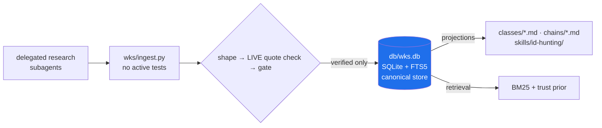

# 🔎 WKS — Web & API Hunting Knowledge System

<p align="center">
  <a href="https://github.com/0xCazuri1337/cybermes-os"></a>
  
  
  
  
</p>

> **A research, curation and retrieval system for practical web/API security knowledge.**
> It fetches published documentation, gates every claim on evidence, and generates per-class hunting skills.
> It performs **no active testing** against any target.

---

## 📋 Table of contents

- [✨ What it is](#-what-it-is)
- [🏗 Architecture](#-architecture)
- [🌳 The tree](#-the-tree)
- [📐 Taxonomy](#-taxonomy-the-shape-is-generated-not-hand-written)
- [🚀 Quick start](#-quick-start)
- [📡 Two source registries](#-two-source-registries-and-why-they-are-not-merged)
- [🧱 Why it is built this way](#-why-it-is-built-this-way)
- [🔓 The quality gate](#-the-quality-gate)
- [🔗 Attack chains](#-attack-chains)
- [✅ Maturity](#-maturity)
- [📜 Operating rules](#-operating-rules)
- [⚠️ Known limitations](#️-known-limitations)

---

## ✨ What it is

**WKS** is the knowledge backbone of a bug-bounty / pentest workflow. Instead of trusting LLM prose, it:

- 📥 **Ingests** delegated research (subagent output) through `wks/ingest.py`.
- 🔍 **Verifies** every cited quote against the live page (`wks/verify_quotes.py`).
- 🚧 **Gates** each item on a 10-dimension quality vector with 15 blocking tags.
- 🗄️ **Stores** the result canonically in `db/wks.db` (SQLite + FTS5) — the only store.
- 📤 **Projects** classes, chains and skills as disposable markdown.
- 🎯 **Retrieves** via BM25 + a trust prior, so a hunter can see which sources back a claim.

> **Design principle:** a citation is not proof, and a fluent, short, confident-sounding claim must not be promotable by averaging.

---

## 🏗 Architecture



The database is canonical. Everything else is a **disposable projection** that can be deleted and rebuilt. `CONTROL/` is hand-authored and is **not** a projection.

<details>
<summary><b>Module map</b> (click to expand)</summary>

| module | responsibility |
|---|---|
| `config.py` | paths (resolved per call), thresholds, weights |
| `store.py` | persistence; the only writer of `validation_state` calls |
| `quality.py` | **the gate** — 10-dimension vector + 15 blocking tags |
| `retrieval.py` | BM25 + trust-prior blending, class digests, chains |
| `pipeline.py` | ingest, prompt-injection sanitiser, seed verification, markdown |
| `verify_quotes.py` | fetches each cited page, confirms the quote is really there |
| `reconcile.py` | supersedes items orphaned when an agent rewrites a file |
| `ingest.py` | the boundary: agent output → verified, gated rows |
| `skillgen.py` | per-class skill generation with version history |
| `chains.py` | first-class attack chains, each step justified |
| `fp.py` | false-positive capture → rejection rules → skill update |
| `evalm.py` | 28 metrics + 8 retrieval probes |
| `cycle.py` | the 12-step autonomous improvement cycle |
| `overnight.py` | bounded, resumable, breadth-preserving unattended loop |
| `taxonomy.py` | WEB seeds (18 classes) with GET-verified seed URLs; `network_taxonomy.py` adds 30 more |
| `seed.py` | registers the taxonomy; refuses un-corroborable classes |

</details>

> **Dependencies:** Python 3.14 standard library only. No embeddings are available on this host, and FTS5 with a trust prior is the better shape anyway: a hunter can see which sources back a claim, which cosine similarity over a mixed corpus of stubs and evidence cannot.

---

## 🌳 The tree

```
domains/                    THE organising boundary. One home per bug class.
  web/                      Browser- and API-mediated HTTP surfaces
    <class_id>/             a SELF-CONTAINED bug-class unit:
      knowledge/              CLASS.md   canonical map, 16-section schema (generated)
                              DIGEST.md  evidence digest from the db (generated)
      skills/                 SKILL.md + HISTORY.md — the hunting skill
      assessment/             COMPETENCY.md — what this class's evidence covers
      chains/  mastery/  labs/
    chains/                 in-domain chains spanning classes
    areas/  topics/         sub-topic pages owned by no single class
    methodology/            how to approach a web class (hand-authored)
  network/                  internal network + infrastructure
    active-directory/         AD specializations, one folder per class
    internal-network/
    infrastructure/
    chains/  methodology/
knowledge/activity/         the learning loop: plans · tasks · sessions · proposals · gaps · progress
knowledge/incoming/pending/ pre-gate material — subagent output, NOT knowledge
runtime/state/    execution state: cycle journals, verification caches
validation/       the gates, the evidence a report needs, FP discipline
reporting/        report structure and severity
tools/taxonomy/   the generator + spec that RENDER domains/ (never hand-edited)
db/wks.db         CANONICAL store — SQLite + FTS5, the only source of truth
quarantine/       material that could not be safely classified
```

> **Active Directory is a specialization under `network`, not a third domain.** Every AD attack path is reached through network access to a protocol, so `domains.py` keeps AD under `NETWORK_SPECIALIZATIONS` and files it at `domains/network/active-directory/<class_id>/`. This is a deliberate deviation from a flat four-domain reading, and `eval/test_domains.py` (66 assertions) enforces it.

> **`knowledge/CLASS.md` and `knowledge/DIGEST.md` are not duplicates.** The class page is the canonical map; the digest is a machine-generated rendering of the db rows behind it. The mapping between a db class id and its canonical page is `CLASS_HOME` in `tools/taxonomy/build_taxonomy.py`.

> **Every path is owned by one function.** `wks/domains.py::class_rel` is the single authority for where a class lives; the generator, skill writer, digest writer and chain writer all call it.

> **Nothing regenerates into a retired root.** `tools/audit_architecture.py` fails if `bug-classes/`, `classes/`, `chains/`, `attack-chains/`, `state/` or a flat `skills/*-hunting/` reappears.

---

## 📐 Taxonomy (the shape is generated, not hand-written)

```bash
python tools/taxonomy/taxonomy_write.py          # render from spec + db
python tools/taxonomy/taxonomy_write.py --check  # drift, exit 1
python tools/taxonomy/audit_taxonomy.py          # rule 9, exit 1 on findings
```

**One canonical home per class.** A concept that appears to belong in two places gets one page and a pointer stub that carries a link and a reason — never a second copy. `domains/web/idor/knowledge/CLASS.md` is canonical for IDOR/BOLA; the `domains/web/topics/` view names point there without duplicating content. LFI, RFI and arbitrary file read/write are Variations of `domains/web/path_traversal/knowledge/CLASS.md`, not separate classes.

---

## 🚀 Quick start

```bash
cd ~/.hermes/cyber

# Gate
python -m wks.cli selftest          # 110 assertions on the quality gate
python -m wks.cli verify-seeds      # every seed URL live, every class >= 2 hosts
python -m wks.cli gaps              # weakest classes first
python -m wks.cli metrics           # 28 quality metrics
python -m wks.cli probe             # 8 retrieval relevance probes
python -m wks.cli report            # last run summary
python -m wks.reconcile             # detect items orphaned by file revisions

# Seed / taxonomy
python -m wks.cli seed              # register the taxonomy (WEB + NETWORK, 70 classes)
python -m wks.cli search "coupon redemption"
python -m wks.cli show idor         # full class digest as JSON

# Unsupervised improvement loop
python -m wks.cli cycle             # one autonomous improvement cycle
python -m wks.cli overnight --cycles 6 --sleep 300
```

**Research intake and learning:**

```bash
python -m wks.cli sources --list                    # research-source registry, by tier
python -m wks.cli sources --register               # register it into the source table
python -m wks.ingest knowledge/incoming/idor.json   # verifies quotes, then gates
python -m wks.reconcile --apply      # supersede orphans after an agent rewrites a file
python -m wks.verify_quotes --file knowledge/incoming/idor.json
python -m wks.fp log --class idor --hypothesis ... --test ... \
    --invalidated-by ... --rule ...                 # false-positive learning
python -m wks.fp list --class idor
python -m wks.cli audit-legacy                     # triage the old corpus
```

---

## 📡 Two source registries, and why they are not merged

| | `taxonomy._SEED` | `wks/research_sources.py` |
|---|---|---|
| **role** | **normative** — defines what a class *is* | **lead list** — technique, intel, tooling |
| typical entries | OWASP, PortSwigger, MITRE CWE, RFC | Medium writeups, community GitBooks, cvebase, tool repos |
| may satisfy the ≥2-host corroboration gate | yes | **no** (R20) |
| tier | T2 primary/normative | T3 practitioner · T4 CVE intel · T5 tooling |

Merging them would let two blog posts corroborate each other and promote a claim with no normative backing — the precise failure this system exists to prevent. Registry sources are registered so they can be **cited and quote-verified**, never so they can define a class. Adding a normative source still means editing `taxonomy._SEED`.

Registry entries carry a measured `access` tier, because **"HTTP 200" is not evidence that content arrived**:

| access | meaning |
|---|---|
| `open` | plain fetch returns content |
| `json` | machine endpoint returns structured data (may be rate-limited) |
| `key` | free tier, but an API key is required |
| `js` | HTTP returns only a loader; needs a script (the 3 Notion pages) |
| `walled` | bot wall or paywall — **a 200 here is a lie** (HackerOne returns `browser-not-supported.html`) |

---

## 🧱 Why it is built this way

The system this replaces promoted **1,380 knowledge items to `validated`**, of which **1,378 had no usable source** and carried invented cross-references (`Ref1`, `Ref2`). Measured over the quarantined corpus:

| defect | count |
|---|---|
| no source refs at all | 1,234 / 1,380 |
| content under 200 chars (truncated teaser) | 1,311 / 1,380 |
| fabricated cross-check references | 1,048 / 1,380 |
| title "RAG Test 0" / "CLI Validate Test" (test fixtures) | 641+ |
| substantial content AND a real citation | **0** |

So the design principle holds: **a citation is not proof**, and a fluent, short, confident-sounding claim must not be promotable by averaging.

---

## 🔓 The quality gate

**Ten dimensions**, weighted (`config.QUALITY_WEIGHTS`): source credibility, technical specificity, evidence strength, reproducibility, corroboration, practical usefulness, recency, internal consistency, real-world demonstration, limitations documented.

A weighted mean alone is not enough, because a short confident stub can score well. **Hard gates** are necessary conditions, not inputs to the average. There are 15 blocking tags in `wks/quality.py::_BLOCKING_TAGS`; the load-bearing ones:

| gate | reason |
|---|---|
| `NO_SOURCES` / `INSUFFICIENT_SOURCES` | no provenance, no claim |
| `INSUFFICIENT_PUBLISHER_HOSTS` | two pages on one host is one publisher, not corroboration |
| `DISCOVERY_ONLY_SOURCE` | social media is a lead, never knowledge |
| `FABRICATED_REFS` | invented citations → **rejected**, not merely held |
| `UNFALSIFIABLE_CLAIM` | "this may be vulnerable" is not a testable claim |
| `OFF_CLASS_TOPIC` / `MODULE_FILLER` | the claim is about another class, or is course prose |
| `LABEL_ONLY_QUOTE` | a second publisher quoting only a CWE label does not corroborate a mechanism |

> Plus one condition outside the database: **every cited quote must actually appear on the cited page.** A subagent claiming it read a source is a self-report. `wks/verify_quotes.py` fetches the page and checks.

> **That check must be tested in both directions.** Its first implementation rejected 11 of 56 genuine quotes (markdown emphasis, table pipes, tag-strip artefacts before punctuation, undecoded HTML entities) — a 19% false-positive rate, all of it my bug and none of it agent misconduct. A verifier that cries wolf gets switched off, and then it protects nothing. `eval/test_wks.py` T13 pins both directions.

**States:** `discovered · under_review · supported · high_confidence · disputed · outdated · rejected · unresolved`. Unresolved is legitimate; it is never presented as established knowledge.

---

## 🔗 Attack chains

Chains are rows, not prose, and **every step must reference an item that exists and has passed the gate** — `chains.py` refuses to build a step on a missing or unpromoted item. Each step carries a `why` and, where the underlying item has one, its `disproof`. An unjustified chain is a story, and a story in a knowledge base is worse than no chain.

---

## ✅ Maturity

`quality.maturity()` computes §29's definition of done rather than asserting it: taxonomy placement, methodology, ≥12 items, ≥4 supported, ≥2 FP rules, ≥1 chain, an independently usable skill. A class missing any of these reports `researching` and names exactly what is missing. `gaps` orders the work queue by a cost model, so an unstarted class outranks a nearly-finished one.

---

## 📜 Operating rules

See `CONTROL/rules.md` — 40 rule rows (37 unique ids), each with how it is checked. The short form:

```bash
python -m wks.cli selftest      # R1 R2 R3 R7 R8  — enforced in code
python -m wks.cli verify-seeds  # R5
python -m wks.cli gaps          # R6
python -m wks.cli metrics       # R4 + unsupported-claim rate
python -m wks.cli report        # R10
python tools/audit_rfc_subjects.py --self-test   # R28
python tools/audit_seed_subjects.py --self-test  # R28
```

---

## ⚠️ Known limitations

Stated plainly, because a knowledge system that hides its gaps is worse than one that reports them:

1. **Retrieval is lexical.** A paraphrase sharing no vocabulary will not match. There is no semantic fallback.
2. **26 of 70 registered classes are still `researching`.** `wks.quality.maturity()` reports **44 mature, 26 researching, 0 planned**. 69 of the 70 classes carry at least one promoted item; `service_enumeration_detail` carries none. A class that is not mature names exactly which of the seven capabilities it lacks.
3. **The gate measures evidence structure, not technical truth.** Two credible sources can still both be wrong. `conflict` rows exist for this: **192** were raised, all as `fabricated-evidence` — **154 dismissed** because the claim never entered the corpus, **30 resolved** after re-cutting and re-ingesting, and **8 currently open** (`pass_the_hash` ×2, `prototype_pollution` ×3, `crlf`, `smuggling`, `xss`).
4. **No automatic staleness re-review.** `outdated` is a state the system can hold but does not yet apply by itself.
5. **The 1,380 quarantined items were not migrated** — 0 passed the gate. The verdict per record is in `runtime/state/legacy-audit.json`.
6. **A promoted item can still be resting on the wrong text.** The gate proves a quote is real, cited by two independent publishers, and about its class — it cannot prove the quote entails the claim. `eval/test_wks_boilerplate.py` catches the mechanical case.

---

<p align="center"><sub>Built for hunters who would rather read a source than trust a summary.</sub></p>
